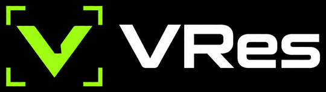

<div align="center">



**Landing de [VRes](https://github.com/Gxnza48/VRes): ajustes de pantalla para gaming, gratis y de código abierto.**

[vresolution.vercel.app](https://vresolution.vercel.app) · [Descargar VRes](https://github.com/Gxnza48/VRes/releases/latest) · [Discord](https://discord.gg/aG2ByWDHfG)

</div>

## Qué es

La página de presentación de VRes. Es estática: **sin base de datos ni servidor**. Lo único que pide el navegador es la última versión publicada, a la API pública de GitHub, para mostrar el número de versión y el enlace directo al instalador.

- Español, inglés y portugués de Brasil (se elige solo según el navegador, y se puede cambiar arriba).
- Demostración interactiva de saturación, Dark Boost y crosshair sobre una escena propia, hecha con filtros SVG.
- Respeta "reducir movimiento" del sistema.

## Desarrollo

```bash
npm install
npm run dev       # http://localhost:5173
npm run build     # verifica tipos y arma dist/
npm run preview   # sirve dist/
```

Stack: Vite, React 19, TypeScript y Tailwind CSS 4. Los textos están todos en `src/copy.ts`.

## Publicación

Vercel la publica sola en cada push a `main` (proyecto `vresolution`). Los encabezados de seguridad (CSP, etc.) están en `vercel.json`.

## Reglas del contenido

- Solo se promete lo que VRes hace de verdad (ver el [README de la app](https://github.com/Gxnza48/VRes#readme)).
- Ningún anti-cheat certifica programas de terceros: la sección de anti-cheats explica cómo está hecho VRes, sin afirmar que un anti-cheat lo haya aprobado.
- Los logos oficiales de juegos y anti-cheats (en `public/brands/` y `src/components/brands.tsx`) se usan solo para identificarlos, con la aclaración de que son de sus dueños y no implican aprobación ni afiliación.
- VirusTotal: la captura es la que pasó el autor (v0.1.0, 24/11/2026, 1 de 69) y se muestra entera, con su versión y fecha. Nunca decir que VirusTotal "certifica", "verifica" o "confía en" VRes: solo analiza. El botón de la versión actual usa el SHA-256 que publica GitHub (`digest` del instalador).
- El hero y la demo usan capturas de Fortnite, VALORANT, CS2 y ROB RUN (`public/scenes/`, JPEG de 1920 px con miniaturas), con el efecto aplicado en el navegador. Las capturas son de sus dueños. No hay capturas inventadas de la app.
